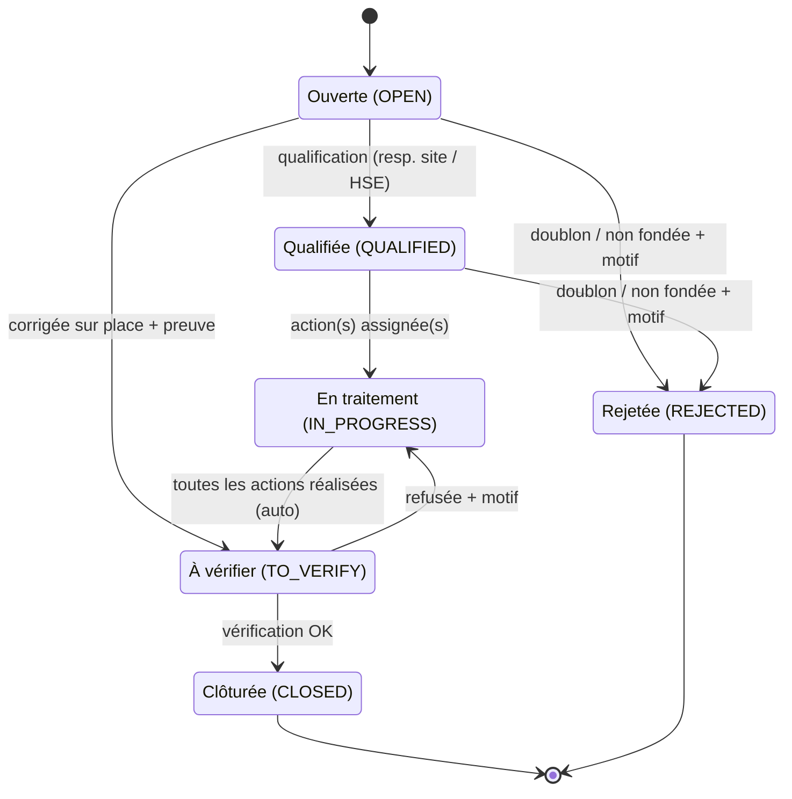
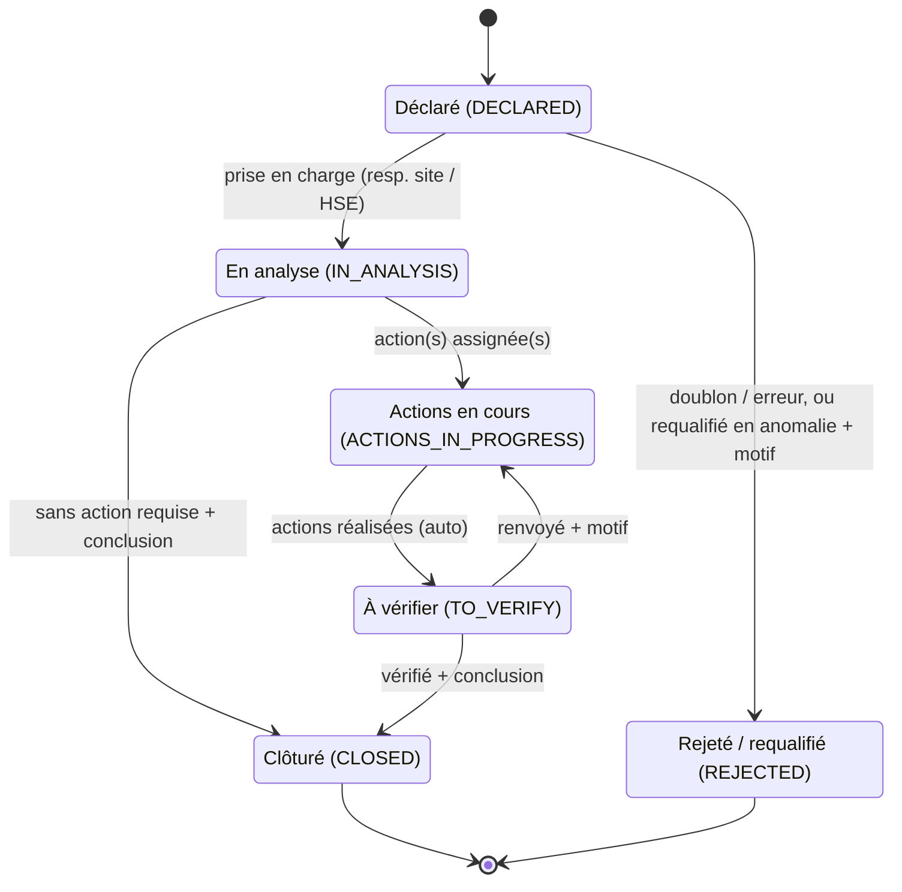
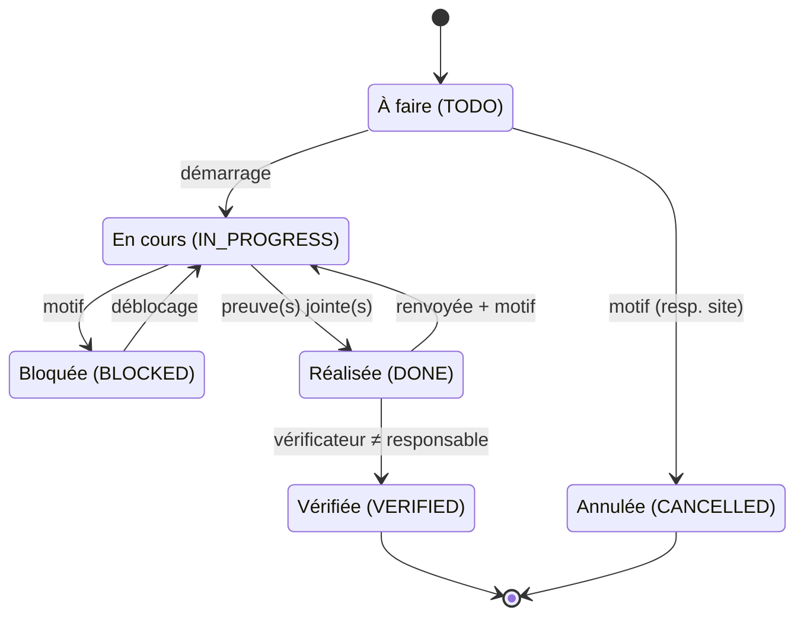
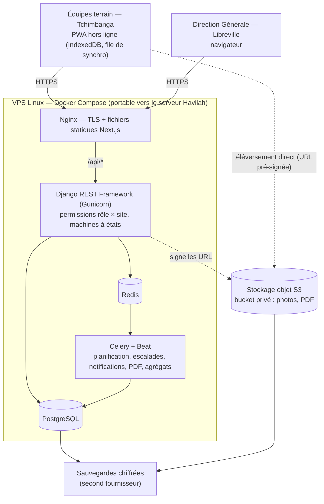

# Havilah SiteCheck — Cahier des charges fonctionnel et technique

> **Version 1.1 — 23 octobre 2026 — document de cadrage révisé, à valider avec Havilah Mining.**
> Source de vérité du projet. Version Markdown du fichier `Cahier_des_charges_HavilahSiteCheck_v1.1.docx`.
> Toute évolution de ce document passe par une nouvelle version (v1.2, …) ; toute décision technique qui s'en écarte passe par un ADR dans `docs/adr/`.

| Champ | Valeur |
|---|---|
| Client | Havilah Mining — Direction Générale (Libreville) et site de Tchimbanga |
| Prestataire | BAKALA Aristote — développeur fullstack & DevSecOps (freelance) |
| Architecture | Next.js en export statique (PWA hors ligne) + Django REST Framework + PostgreSQL + Redis/Celery + stockage objet S3 |
| Statut | Phase 1 (socle et preuve hors ligne) autorisée ; points ouverts listés au §24.2 |

## Historique des versions

| Version | Date | Objet |
|---|---|---|
| 1.0 | 23/10/2026 | Document de cadrage initial. |
| 1.1 | 23/10/2026 | Revue d'ingénierie : anomalie et incident distincts, hors-ligne de 1 à 3 jours, appareils personnels, PostgreSQL, VPS, montée en charge vers 1 000 utilisateurs, exigences numérotées et priorisées. |

# 1. Résumé exécutif

Havilah SiteCheck est une application web orientée mobile qui structure les inspections terrain, la remontée des anomalies et des incidents, et le suivi des actions correctives d'Havilah Mining. Les équipes de Tchimbanga collectent des informations standardisées et prouvées, y compris sans réseau pendant plusieurs jours. La Direction Générale à Libreville dispose d'une vue consolidée de la situation opérationnelle et des points qui demandent une décision.

Aujourd'hui, ces informations circulent par appels téléphoniques et messages WhatsApp. L'application devient la **source de vérité unique** : une anomalie ou un incident n'est réputé transmis qu'une fois enregistré dans SiteCheck.

Le produit ne remplace pas un système spécialisé de santé-sécurité, de maintenance (GMAO) ou de gestion minière. Il démarre avec environ **10 utilisateurs** en pilote, mais l'architecture est dimensionnée pour atteindre **1 000 utilisateurs et 1 000 inspections par jour** sans réécriture.

# 2. Contexte et problématique

- La Direction Générale (Libreville) et le site opérationnel (Tchimbanga) sont géographiquement séparés.
- Les remontées terrain passent par des appels et des messages WhatsApp : l'information est dispersée, non structurée, difficile à retrouver et sans responsable clairement désigné.
- Il est difficile de savoir rapidement quelles inspections ont été faites, quelles anomalies et quels incidents sont ouverts, qui doit agir et ce qui est en retard.
- La connectivité du site est irrégulière : **une équipe peut rester de 1 à 3 jours sans réseau**.
- Chaque employé utilise **son propre téléphone** : l'application doit fonctionner sur un parc hétérogène (Android et iPhone) qui n'appartient pas à l'entreprise.
- Havilah ne dispose pas de DSI : l'exploitation technique est assurée par le prestataire, ce qui impose une solution simple à exploiter et bien documentée.
- Les décisions et les clôtures doivent être justifiées par un historique et des preuves photographiques ou documentaires.

# 3. Objectifs et indicateurs de succès

## 3.1. Objectifs

- Numériser les inspections récurrentes par site, zone, catégorie et fréquence, avec une planification automatique.
- Faire remonter les anomalies (écarts constatés) et déclarer les incidents (événements survenus) avec priorité, preuves, localisation et responsable.
- Suivre les actions correctives jusqu'à leur vérification et leur clôture, avec escalade automatique des retards.
- Donner à la Direction une vue synthétique orientée décision : critiques, retards, inspections manquées, tendances.
- Remplacer les échanges WhatsApp de suivi par un fil de commentaires attaché à chaque fiche.
- Permettre le travail hors connexion de 1 à 3 jours puis la synchronisation sans perte ni doublon.
- Conserver une piste d'audit des opérations importantes.
- Préparer la montée en charge (10 → 1 000 utilisateurs) et l'ajout d'autres sites sans surdimensionner le pilote.

## 3.2. Indicateurs de succès du pilote

Valeurs proposées, à valider avec la Direction en phase 0. Elles sont mesurées sur les 4 dernières semaines du pilote.

| Indicateur | Définition | Cible proposée |
|---|---|---|
| Taux de réalisation des inspections | Inspections soumises / inspections planifiées sur la période | ≥ 90 % |
| Adoption | Part des anomalies et incidents enregistrés dans SiteCheck plutôt que signalés uniquement par WhatsApp ou téléphone | ≥ 80 % |
| Réactivité sur les critiques | Anomalies et incidents critiques qualifiés dans le délai SLA | 100 % |
| Délai de clôture | Délai médian entre constat et clôture d'une anomalie de priorité haute | ≤ 7 jours |
| Fiabilité de la synchronisation | Lots synchronisés sans intervention manuelle | ≥ 99 % |
| Utilisation | Utilisateurs actifs au moins une fois par semaine / utilisateurs inscrits | ≥ 80 % |

# 4. Glossaire

Les termes ci-dessous ont un sens précis dans tout le document et dans l'application. Ils doivent être validés par Havilah, en particulier la distinction entre anomalie et incident.

| Terme | Définition |
|---|---|
| **Site** | Lieu d'exploitation (ex. Tchimbanga). Toute donnée opérationnelle est rattachée à un site. |
| **Zone** | Sous-ensemble d'un site : atelier, magasin, bureaux, zone de stockage, salle IT, parc d'engins, etc. |
| **Modèle d'inspection** | Liste de contrôle réutilisable (questions, types de réponse, règles). Chaque publication crée une version immuable. |
| **Planification** | Règle qui génère des inspections à faire (modèle, zone, fréquence, exécutant). |
| **Inspection** | Une occurrence de contrôle réalisée par un exécutant avec une version de modèle donnée. |
| **Non-conformité** | Réponse d'inspection hors exigence (non conforme, hors bornes). |
| **Anomalie** | Écart ou état anormal constaté qui nécessite une correction : extincteur périmé, garde-corps endommagé, fuite d'huile sur un engin, câble dénudé, EPI manquant. Issue d'une inspection ou signalée librement. |
| **Incident** | Événement survenu ayant eu ou pouvant avoir des conséquences : accident de travail, presque-accident, panne majeure en opération, déversement, incendie, intrusion, coupure réseau totale. Il possède une date de survenue, une gravité réelle et potentielle, et peut impliquer des personnes. |
| **Requalification** | Transformation d'une anomalie en incident (ou l'inverse), avec conservation du lien et de l'historique. |
| **Action corrective** | Tâche assignée à un responsable avec échéance et résultat attendu, rattachée à une anomalie ou à un incident. |
| **Vérification** | Contrôle, par une personne autre que le responsable de l'action, que la correction est effective. |
| **SLA de traitement** | Délais cibles de qualification, de prise en charge et de résolution selon la priorité (§8.5). |
| **Escalade** | Notification automatique à un niveau hiérarchique supérieur quand un délai SLA est dépassé. |
| **Synchronisation** | Envoi au serveur des opérations saisies hors ligne, et récupération des mises à jour. |
| **Appareil enregistré** | Téléphone ou ordinateur d'un utilisateur, connu du serveur et révocable. |
| **Défaut logiciel** | Bogue de l'application. Ce terme est utilisé pour ne pas confondre avec une « anomalie » terrain. |

# 5. Périmètre et priorisation

Chaque exigence du §7 porte une priorité MoSCoW :

| Code | Signification |
|---|---|
| **M — Must** | Indispensable au pilote. Sans elle, le pilote ne démarre pas. |
| **S — Should** | Importante, prévue en V1 ; peut glisser de quelques semaines si nécessaire. |
| **C — Could** | Souhaitable ; réalisée si le temps le permet, sinon reportée en V2. |
| **W — Won't** | Explicitement exclue de la V1. |

| Inclus dans la V1 | Prévu en V2 (après pilote) | Hors périmètre |
|---|---|---|
| Authentification, rôles, appareils | Constructeur visuel de modèles d'inspection | Paie, RH, gestion complète des employés |
| Sites, zones, catégories, registre léger d'équipements | Notifications WhatsApp Business ou SMS | ERP minier, gestion de production |
| Modèles d'inspection (via l'administration) et planification | Qualification d'anomalies hors ligne par le responsable de site | Télémétrie IoT, intégration aux engins |
| Inspections, anomalies, incidents, actions correctives | Géolocalisation de preuve (sur validation) | GMAO complète (stocks, coûts, maintenance préventive) |
| Hors ligne 1 à 3 jours et synchronisation | Code PIN applicatif local | Reconnaissance automatique des risques par IA |
| Tableau de bord DG, notifications, escalades | Ouverture à d'autres sites et organisations | Suivi GPS continu des employés ou véhicules |
| Rapports PDF/CSV, journal d'audit | Tendances avancées et comparaison entre sites | Signature électronique qualifiée ; intégrations ERP/comptabilité |

# 6. Utilisateurs, rôles et permissions

| Rôle | Description |
|---|---|
| **Administrateur technique** | Prestataire. Paramètre comptes, rôles, sites, catégories, modèles et paramètres globaux. N'a pas accès par défaut aux sections restreintes des incidents. |
| **Direction Générale (DG)** | Consulte tous les sites autorisés, examine les éléments critiques et les escalades, commente, demande des actions, exporte. |
| **Responsable de site** | Pilote les opérations de son site : planifie, qualifie, assigne, vérifie et clôture. |
| **Responsable HSE** | Prend en charge les incidents et les anomalies de sécurité et d'environnement ; accès à la section « personnes impliquées ». Rôle à confirmer (voir §24). |
| **Inspecteur / superviseur terrain** | Réalise les inspections, crée des anomalies, déclare des incidents. |
| **Technicien / responsable d'action** | Traite les actions qui lui sont assignées et fournit les preuves. |
| **Lecteur / auditeur** | Lecture seule des données et rapports explicitement autorisés. |

Un utilisateur peut avoir des rôles différents sur des sites différents. Tous les rôles, sauf la DG et l'administrateur, sont limités à leurs sites. **Les permissions sont vérifiées côté serveur sur chaque requête et sur chaque objet** ; masquer un bouton dans l'interface n'est pas un contrôle d'accès.

### Matrice des permissions

| Action | Admin | DG | Resp. site | HSE | Inspect. | Techn. | Lecteur |
|---|---|---|---|---|---|---|---|
| Réaliser une inspection | — | — | ✓ | ✓ | ✓ | (✓) | — |
| Créer une anomalie | — | — | ✓ | ✓ | ✓ | ✓ | — |
| Déclarer un incident | — | ✓ | ✓ | ✓ | ✓ | ✓ | — |
| Qualifier / rejeter une anomalie | — | — | ✓ | (✓) | — | — | — |
| Prendre en charge un incident | — | — | ✓ | ✓ | — | — | — |
| Créer / assigner une action | — | (✓) | ✓ | ✓ | — | — | — |
| Mettre à jour une action assignée | — | — | ✓ | ✓ | ✓ | ✓ | — |
| Vérifier / clôturer | — | — | ✓ | ✓ | — | — | — |
| Voir les personnes impliquées | — | ✓ | ✓ | ✓ | — | — | — |
| Tableau de bord multi-sites | — | ✓ | — | — | — | — | (✓) |
| Exporter des rapports | — | ✓ | ✓ | ✓ | — | — | (✓) |
| Gérer modèles et planifications | ✓ | — | (✓) | (✓) | — | — | — |
| Gérer comptes et appareils | ✓ | — | — | — | — | — | — |
| Consulter le journal d'audit | ✓ | ✓ | — | — | — | — | — |

(✓) = sous condition : technicien seulement si une inspection lui est assignée ; HSE pour les catégories sécurité et environnement ; DG en « demande d'action » ; responsable de site et HSE pour les planifications de leur périmètre ; lecteur sur le périmètre explicitement autorisé. Personne ne peut vérifier une action dont il est responsable.

# 7. Exigences fonctionnelles

## 7.1. Authentification, comptes et appareils

| ID | Exigence | Prio. |
|---|---|---|
| EF-AUT-01 | Connexion par identifiant (e-mail ou matricule) et mot de passe ; déconnexion ; réinitialisation par e-mail ou par l'administrateur pour les employés sans adresse e-mail. | M |
| EF-AUT-02 | Session Django par cookie httpOnly, Secure, SameSite, sur la même origine que l'application ; durée glissante de 7 jours, compatible avec un retour de terrain après 3 jours sans réseau. | M |
| EF-AUT-03 | Fenêtre hors ligne : l'application reste utilisable hors connexion jusqu'à 96 h après la dernière authentification en ligne réussie sur l'appareil. Au-delà, une reconnexion est exigée avant toute nouvelle saisie ; les données en attente ne sont jamais supprimées. | M |
| EF-AUT-04 | Chaque appareil est enregistré à la connexion (nom, navigateur, dernière synchronisation). L'utilisateur et l'administrateur peuvent le révoquer ; un appareil révoqué voit sa synchronisation refusée et ses données locales purgées au prochain contact. | M |
| EF-AUT-05 | Un utilisateur peut appartenir à plusieurs sites avec un rôle par site. | M |
| EF-AUT-06 | Activation, désactivation de comptes et révocation immédiate des sessions (départ d'un employé). | M |
| EF-AUT-07 | Limitation des tentatives de connexion et journalisation des événements de sécurité. | M |
| EF-AUT-08 | Double authentification (TOTP) obligatoire pour l'administrateur et la DG. | S |

## 7.2. Référentiels

| ID | Exigence | Prio. |
|---|---|---|
| EF-REF-01 | Sites et zones (un niveau de hiérarchie en V1), avec statut actif ou archivé. | M |
| EF-REF-02 | Catégories configurables pour les inspections et anomalies (sécurité, environnement, équipements, infrastructure, véhicules, IT/réseau…) ; types d'incident distincts (§7.7). | M |
| EF-REF-03 | Registre léger des équipements (code, libellé, zone, statut disponible ou indisponible) pour rattacher anomalies et incidents. | S |
| EF-REF-04 | Gestion des référentiels par l'interface d'administration Django personnalisée en V1, sans écran dédié. | M |
| EF-REF-05 | Toute donnée opérationnelle est rattachée à un site ; archivage logique plutôt que suppression. | M |

## 7.3. Modèles d'inspection

| ID | Exigence | Prio. |
|---|---|---|
| EF-MOD-01 | Un modèle comporte un titre, une catégorie, les sites et zones concernés, le rôle exécutant et des questions ordonnées par sections. | M |
| EF-MOD-02 | Types de réponse : conforme / non conforme / non applicable, oui / non, texte, nombre avec bornes, choix unique ou multiple, photo. | M |
| EF-MOD-03 | Règle par question : une réponse non conforme ou hors bornes exige un commentaire et/ou une photo et propose une anomalie pré-remplie. | M |
| EF-MOD-04 | Publication avec numéro de version immuable ; toute modification crée une nouvelle version ; chaque inspection conserve la version utilisée. | M |
| EF-MOD-05 | Édition par l'administration Django (formulaires imbriqués) avec aperçu du rendu mobile. | M |
| EF-MOD-06 | Duplication d'un modèle vers un autre site. | S |
| EF-MOD-07 | Constructeur visuel de modèles (glisser-déposer, logique conditionnelle avancée). | W |

## 7.4. Planification des inspections

| ID | Exigence | Prio. |
|---|---|---|
| EF-PLA-01 | Une planification définit : modèle, site/zone, fréquence (quotidienne, hebdomadaire avec jours choisis, mensuelle, ponctuelle), exécutant (personne ou rôle), dates de début et de fin. | M |
| EF-PLA-02 | Une tâche planifiée génère les inspections à faire au moins 7 jours à l'avance, pour qu'elles soient disponibles hors ligne. | M |
| EF-PLA-03 | Fenêtre de réalisation et délai de grâce par planification. « En retard » et « manquée » sont des indicateurs calculés, pas des statuts saisis. | M |
| EF-PLA-04 | Tous les calculs d'échéance utilisent le fuseau de l'organisation (Africa/Libreville, UTC+1). | M |
| EF-PLA-05 | Calendrier des jours non travaillés par site (jours fériés, arrêts), exclus des échéances. | S |
| EF-PLA-06 | Inspection ponctuelle hors planification, si le rôle l'autorise. | S |

## 7.5. Réalisation d'une inspection

| ID | Exigence | Prio. |
|---|---|---|
| EF-INS-01 | Accueil terrain « À faire / En cours / Soumises », disponible hors ligne. | M |
| EF-INS-02 | Saisie section par section ; enregistrement local automatique à chaque réponse ; reprise d'un brouillon interrompu. | M |
| EF-INS-03 | Photo prise depuis l'appareil ; compression côté client (côté le plus long ≤ 1 600 px, cible 150 à 350 Ko) ; suppression des métadonnées EXIF, dont la position GPS, avant envoi. | M |
| EF-INS-04 | Sont enregistrés : exécutant, site, zone, version du modèle, heures de début et de fin selon l'appareil, heure de réception par le serveur. | M |
| EF-INS-05 | À la soumission : récapitulatif des non-conformités et création des anomalies correspondantes (une par non-conformité, regroupement possible). | M |
| EF-INS-06 | Une inspection soumise n'est plus modifiable ; une correction passe par un commentaire ou une nouvelle inspection. | M |
| EF-INS-07 | Taux de conformité calculé uniquement selon une formule validée par Havilah (réponses « non applicable » exclues). | S |

## 7.6. Anomalies

| ID | Exigence | Prio. |
|---|---|---|
| EF-ANO-01 | Création depuis une inspection ou librement : titre, description, catégorie, site, zone, équipement (facultatif), priorité proposée, photos. | M |
| EF-ANO-02 | Option « corrigée sur place » avec preuve obligatoire : l'anomalie passe directement à « À vérifier ». | M |
| EF-ANO-03 | Qualification par le responsable de site (ou HSE) : priorité définitive, échéance calculée selon la matrice SLA, ou rejet motivé (doublon, non fondée). | M |
| EF-ANO-04 | Création d'une ou plusieurs actions correctives ; passage automatique à « À vérifier » quand toutes les actions sont réalisées. | M |
| EF-ANO-05 | Requalification en incident : création d'un incident lié ; l'anomalie conserve son historique. | M |
| EF-ANO-06 | Fil de commentaires horodaté par anomalie, avec mention de personnes (@nom). Il remplace les échanges WhatsApp de suivi. | M |
| EF-ANO-07 | Signalement des doublons probables au déclarant (même zone, équipement et catégorie, anomalie ouverte récente). | S |

## 7.7. Incidents

| ID | Exigence | Prio. |
|---|---|---|
| EF-INC-01 | Déclaration rapide, en moins d'une minute : type, site, zone, date et heure de survenue, description courte, photo facultative. Les autres champs sont complétés ensuite. | M |
| EF-INC-02 | Types configurables : accident de travail, presque-accident, dommage matériel, panne majeure, environnemental, sûreté (vol, intrusion), IT/réseau. | M |
| EF-INC-03 | Gravité réelle et gravité potentielle (matrice à valider), mesures immédiates prises, témoins. | M |
| EF-INC-04 | Les personnes impliquées et la nature des blessures sont dans une section à accès restreint (DG, responsable de site, HSE), y compris pour l'API et les exports. | M |
| EF-INC-05 | Un incident de gravité critique notifie immédiatement la DG, le responsable de site et le HSE. Un message permanent rappelle : « En cas d'urgence, appelez d'abord. » | M |
| EF-INC-06 | Cause(s) et conclusion obligatoires à la clôture pour une gravité haute ou critique. | M |
| EF-INC-07 | Liens vers les actions correctives et les anomalies associées. | M |
| EF-INC-08 | Rapport d'incident exportable en PDF. | S |

## 7.8. Actions correctives et vérification

| ID | Exigence | Prio. |
|---|---|---|
| EF-ACT-01 | Une action est rattachée soit à une anomalie, soit à un incident (exactement l'un des deux). | M |
| EF-ACT-02 | Responsable, échéance, résultat attendu et types de preuves exigées. | M |
| EF-ACT-03 | Transitions selon le cycle de vie du §8.4 ; motif obligatoire pour « Bloquée », « Renvoyée » et « Annulée ». | M |
| EF-ACT-04 | Le vérificateur ne peut pas être le responsable de l'action, sauf dérogation paramétrée pour la priorité basse. | M |
| EF-ACT-05 | « Mes actions » consultables et mises à jour hors ligne (statut, commentaire, preuve). | M |
| EF-ACT-06 | Indicateur de retard calculé et escalade automatique selon la matrice SLA. | M |

## 7.9. Tableau de bord Direction Générale

| ID | Exigence | Prio. |
|---|---|---|
| EF-DSH-01 | Bloc « À traiter » en tête : incidents critiques ouverts, anomalies critiques non qualifiées, actions en retard, escalades en attente de décision. | M |
| EF-DSH-02 | Indicateurs par site et période : inspections prévues, réalisées et manquées, taux de réalisation, anomalies et incidents ouverts par priorité, délai médian de clôture. | M |
| EF-DSH-03 | Chaque indicateur affiche sa définition, sa période et son heure de mise à jour ; un clic ouvre la liste des éléments comptés. | M |
| EF-DSH-04 | Indication de fraîcheur : dernière synchronisation par équipe, pour signaler que des données terrain peuvent être en attente. | M |
| EF-DSH-05 | La DG peut commenter, demander une action ou relancer, sans modifier les preuves terrain. | M |
| EF-DSH-06 | Tendances sur 12 semaines ; export PDF et CSV. | S |
| EF-DSH-07 | Score global de « santé du site » tant qu'aucune formule métier n'est validée. | W |

## 7.10. Notifications et escalades

| ID | Exigence | Prio. |
|---|---|---|
| EF-NOT-01 | Centre de notifications dans l'application : assignation, changement de statut, échéance proche, retard, escalade, mention. | M |
| EF-NOT-02 | Notifications push web : Android ; iPhone uniquement si l'application est installée sur l'écran d'accueil (iOS 16.4 ou plus). | S |
| EF-NOT-03 | E-mail pour la DG et les responsables : alertes critiques et récapitulatif quotidien. | S |
| EF-NOT-04 | Règles de destinataires par site, catégorie et priorité ; regroupement pour éviter la surcharge. | M |
| EF-NOT-05 | Escalade automatique par tâche planifiée, selon la matrice SLA. | M |
| EF-NOT-06 | File d'envoi avec nouvelles tentatives et journal des échecs. | M |
| EF-NOT-07 | Aucune donnée sensible dans le contenu des notifications : ni noms de personnes impliquées, ni détails d'incident. Seuls la référence, le type et un lien. | M |
| EF-NOT-08 | Canal WhatsApp Business (messages modèles avec référence et lien) ou SMS, après validation des coûts. | W |

## 7.11. Hors connexion et synchronisation

| ID | Exigence | Prio. |
|---|---|---|
| EF-OFF-01 | Application web progressive (PWA) installable. Sont mis en cache : l'application, les référentiels des sites de l'utilisateur, les modèles publiés, les inspections des 7 prochains jours et les actions assignées. | M |
| EF-OFF-02 | Autonomie cible : 3 jours de travail sans réseau (fenêtre de 96 h) avec au moins 150 photos compressées stockées localement. | M |
| EF-OFF-03 | Identifiants UUID générés sur l'appareil ; les références lisibles (HSC-ANO-…) sont attribuées à la synchronisation, avec la mention « référence en attente » jusque-là. | M |
| EF-OFF-04 | File d'opérations persistante (IndexedDB) envoyée par lots idempotents. Les photos sont d'abord téléversées vers le stockage par URL pré-signée, puis référencées. | M |
| EF-OFF-05 | Synchronisation à l'ouverture, au retour du réseau et périodiquement tant que l'application est ouverte. Aucune dépendance à la synchronisation en arrière-plan, non prise en charge sur iPhone. | M |
| EF-OFF-06 | États visibles par élément et globalement : sur l'appareil, en attente, synchronisé, échec à résoudre. Compteur d'éléments en attente sur l'accueil. | M |
| EF-OFF-07 | Gestion des conflits : les objets créés hors ligne n'entrent pas en conflit (UUID) ; les commentaires sont en ajout seul ; les transitions de statut sont revalidées par le serveur, refusées si l'état a changé, et placées dans une liste « À résoudre ». Jamais d'écrasement silencieux. | M |
| EF-OFF-08 | Demande de stockage persistant au navigateur ; alerte à 80 % du quota ; aucune purge automatique de données non synchronisées. | M |
| EF-OFF-09 | Purge des données locales déjà synchronisées après 30 jours et à la déconnexion (après synchronisation complète). | M |
| EF-OFF-10 | Écran de diagnostic : dernière synchronisation, espace utilisé, version de l'application ; export de secours chiffré des données en attente à destination du support. | S |

### Matrice des fonctions disponibles hors ligne

| Fonction | Hors ligne | Remarque |
|---|---|---|
| Consulter les inspections planifiées (7 jours) | Oui | Mises en cache à chaque synchronisation. |
| Réaliser et soumettre une inspection, avec photos | Oui | Photos compressées ; quota surveillé. |
| Créer une anomalie | Oui | Référence attribuée à la synchronisation. |
| Déclarer un incident | Oui | La notification ne part qu'au retour du réseau : en cas d'urgence, appeler. |
| Mettre à jour ses actions (statut, commentaire, preuve) | Oui | Transition revalidée par le serveur. |
| Consulter les référentiels de ses sites | Oui | Sites, zones, équipements, catégories. |
| Historique des anomalies de sa zone | Partiel | 30 derniers jours, sans pièces jointes lourdes. |
| Qualifier, assigner, vérifier, clôturer | Non (V1) | Opérations en ligne pour éviter les conflits ; à réévaluer selon la connectivité réelle du responsable de site. |
| Tableau de bord DG, rapports, administration | Non | Usage depuis Libreville, en ligne. |

## 7.12. Rapports et journal d'audit

| ID | Exigence | Prio. |
|---|---|---|
| EF-RAP-01 | Rapport d'inspection PDF : réponses, non-conformités, photos sélectionnées, auteur, horodatages appareil et serveur. | M |
| EF-RAP-02 | Rapport périodique par site (hebdomadaire, mensuel) généré en tâche de fond. | M |
| EF-RAP-03 | Journal d'audit en ajout seul : connexions, créations, transitions, assignations, exports, opérations d'administration, révocations d'appareils. | M |
| EF-RAP-04 | Exports réservés aux rôles autorisés, et eux-mêmes journalisés. | M |
| EF-RAP-05 | Envoi automatique du rapport hebdomadaire à la DG par e-mail. | S |

# 8. Cycles de vie et délais de traitement

## 8.1. Anomalie ou incident ?

| Critère | Anomalie | Incident |
|---|---|---|
| **Nature** | Un état ou un écart constaté | Un événement survenu |
| **Question clé** | « Qu'est-ce qui ne va pas ? » | « Que s'est-il passé ? » |
| **Origine** | Inspection ou signalement libre | Déclaration (souvent urgente) |
| **Champs propres** | Équipement, non-conformité d'origine, corrigée sur place | Date de survenue, gravité réelle et potentielle, mesures immédiates, témoins, personnes impliquées, causes, conclusion |
| **Confidentialité** | Standard (site) | Section restreinte pour les personnes et blessures |
| **Exemples** | Extincteur périmé, garde-corps endommagé, fuite d'huile | Accident, presque-accident, déversement, intrusion |
| **Liens** | Peut être requalifiée en incident | Peut révéler des anomalies ; peut être requalifié en anomalie |

« En retard » n'est jamais un statut : c'est un indicateur calculé à partir de l'échéance. Un objet peut donc être « En traitement » et en retard à la fois. Chaque transition est historisée (acteur, horodatage serveur, ancien et nouvel état, motif).

## 8.2. Cycle de vie d'une anomalie

Si la vérification d'une anomalie « corrigée sur place » est refusée, le vérificateur crée une action corrective et l'anomalie passe « En traitement ».

## 8.3. Cycle de vie d'un incident

## 8.4. Cycle de vie d'une action corrective

## 8.5. Matrice des délais (SLA) et escalades

Valeurs données à titre d'exemple pour lancer la discussion : **elles doivent être fixées par Havilah en phase 0**. Les délais courent à partir de l'heure de constat déclarée ; l'écart entre constat et réception serveur (données hors ligne) est affiché.

| Priorité | Qualification | Action assignée | Résolution cible | Escalade |
|---|---|---|---|---|
| **Critique** | 2 h | 4 h | 24 à 72 h selon la nature | DG immédiatement informée ; relance DG si qualification \> 2 h |
| **Haute** | 24 h | 48 h | 7 jours | Responsable de site, puis DG à +48 h de retard |
| **Moyenne** | 72 h | 5 jours | 30 jours | Responsable de site |
| **Basse** | 7 jours | — | 90 jours | Aucune (récapitulatif mensuel) |

## 8.6. Codes techniques des états

Ajout de la version Markdown, pour le code : les états sont stockés sous ces codes (énumérations), les libellés français restent dans l'interface. « En retard » et « manquée » ne sont pas des états mais des indicateurs calculés.

| Objet | Codes |
|---|---|
| Inspection | `SCHEDULED`, `IN_PROGRESS`, `SUBMITTED`, `CANCELLED` (+ indicateurs calculés `is_overdue`, `is_missed`) |
| Anomalie | `OPEN`, `QUALIFIED`, `IN_PROGRESS`, `TO_VERIFY`, `CLOSED`, `REJECTED` |
| Incident | `DECLARED`, `IN_ANALYSIS`, `ACTIONS_IN_PROGRESS`, `TO_VERIFY`, `CLOSED`, `REJECTED` |
| Action corrective | `TODO`, `IN_PROGRESS`, `BLOCKED`, `DONE`, `VERIFIED`, `CANCELLED` |
| Synchronisation (sur l'appareil) | `LOCAL`, `PENDING`, `SYNCED`, `FAILED`, `CONFLICT` |

# 9. Parcours utilisateurs

### Parcours A — Inspection terrain sans réseau

1.  L'inspecteur ouvre l'application (déjà synchronisée la veille) ; l'accueil liste les inspections du jour, même sans réseau.
2.  Il réalise l'inspection ; chaque réponse est enregistrée sur l'appareil immédiatement.
3.  Une non-conformité exige une photo et un commentaire, et prépare une anomalie pré-remplie.
4.  Il soumet : l'application indique « enregistrée sur l'appareil — en attente de synchronisation ».
5.  Deux jours plus tard, au retour du réseau, la synchronisation part à l'ouverture de l'application ; les références sont attribuées.
6.  Le responsable de site et la DG voient les résultats, avec l'écart entre heure de constat et heure de réception.

### Parcours B — Traitement d'une anomalie

1.  Le responsable de site reçoit la notification et qualifie l'anomalie (priorité, échéance) ou la rejette avec motif.
2.  Il crée une action et l'assigne à un technicien.
3.  Le technicien réalise l'intervention, ajoute une photo de preuve et passe l'action à « Réalisée », éventuellement hors ligne.
4.  L'anomalie passe automatiquement « À vérifier » ; le vérificateur accepte ou renvoie avec motif.
5.  Les échanges se font dans le fil de commentaires de la fiche, pas sur WhatsApp.

### Parcours C — Déclaration d'un incident

1.  Un presque-accident survient sur le parc d'engins. Si une personne est en danger, l'employé appelle d'abord les secours internes.
2.  Il déclare l'incident en moins d'une minute : type, zone, heure, description courte, photo.
3.  À réception, la DG, le responsable de site et le HSE sont notifiés selon la gravité.
4.  Le HSE prend en charge, complète la gravité, les témoins et les mesures immédiates, puis lance les actions.
5.  À la clôture, causes et conclusion sont obligatoires pour une gravité haute ou critique.

### Parcours D — Revue par la DG

1.  La DG ouvre le tableau de bord : le bloc « À traiter » affiche les critiques, retards et escalades.
2.  Elle ouvre un élément, consulte preuves et historique, commente ou demande une action.
3.  Elle vérifie l'indication de fraîcheur pour savoir si des équipes n'ont pas encore synchronisé.
4.  Elle exporte le rapport hebdomadaire pour la réunion de suivi.

# 10. Écrans attendus

| Écran | Contenu minimum | Prio. |
|---|---|---|
| **Connexion** | Identifiant, mot de passe, récupération de compte, erreurs explicites. | M |
| **Accueil terrain** | Inspections à faire, brouillons, actions assignées, compteur de synchronisation, bouton « Déclarer un incident » toujours visible. | M |
| **Inspection (liste et saisie)** | Progression par section, réponses, photos, récapitulatif des non-conformités, soumission. | M |
| **Anomalie (liste et fiche)** | Priorité, preuves, actions, échéance, fil de commentaires, historique. | M |
| **Incident (déclaration rapide et fiche)** | Formulaire court, puis fiche complète avec section restreinte. | M |
| **Mes actions** | Actions assignées, échéances, statut, ajout de preuve. | M |
| **File de synchronisation** | Éléments en attente, en échec, « À résoudre », diagnostic. | M |
| **Tableau de bord DG** | Bloc « À traiter », indicateurs, filtres site et période. | M |
| **Notifications** | Liste, lu / non lu, accès direct à la fiche. | M |
| **Rapports et audit** | Recherche, filtres, exports autorisés. | M |
| **Administration** | Interface Django personnalisée : comptes, appareils, sites, catégories, modèles, planifications, SLA. | M |

Contraintes d'ergonomie terrain : cibles tactiles d'au moins 48 px, utilisation à une main, contraste élevé lisible en plein soleil, peu de saisie clavier (listes, boutons, photos).

# 11. Exigences non fonctionnelles

| Domaine | Exigence cible |
|---|---|
| **Usage terrain** | Priorité au mobile ; cibles tactiles ≥ 48 px ; lisible en plein soleil ; utilisable à une main. |
| **Performance terrain** | Accueil terrain affiché en moins de 2 s depuis le cache, avec ou sans réseau ; enregistrement d'une réponse instantané (local). |
| **Performance API** | 95 % des lectures et listes paginées en moins de 800 ms côté serveur au palier cible (hors fichiers et rapports). |
| **Capacité** | 1 000 utilisateurs, 1 000 inspections par jour et pics de synchronisation (§12). |
| **Consommation de données** | Moins de 5 Mo par jour et par inspecteur en usage normal (forfaits personnels). |
| **Autonomie hors ligne** | Fenêtre de 96 h ; au moins 150 photos compressées en attente. |
| **Disponibilité** | 99,5 % par mois hors maintenance annoncée, soit environ 3 h 40 d'indisponibilité au maximum. |
| **Sauvegarde** | Perte de données maximale (RPO) ≤ 1 h ; délai de remise en service (RTO) ≤ 8 h ouvrées. À valider. |
| **Compatibilité** | Android 10 ou plus (Chrome récent) ; iOS 16.4 ou plus (Safari, application installée) ; navigateurs récents sur ordinateur. Liste d'appareils de référence établie en phase 0. |
| **Accessibilité** | Libellés explicites, erreurs compréhensibles, contraste conforme WCAG 2.1 AA. |
| **Sécurité** | Vérification selon OWASP ASVS niveau 2 (§16). |
| **Observabilité** | Logs structurés avec identifiant de corrélation ; erreurs frontend et backend remontées ; aucun secret ni donnée personnelle dans les logs. |
| **Portabilité** | Déploiement identique sur VPS ou sur le serveur Havilah (conteneurs) ; aucun service propriétaire d'un fournisseur hormis un stockage compatible S3. |
| **Langue** | Français en V1 ; libellés externalisés pour une traduction ultérieure. |

# 12. Dimensionnement et montée en charge

L'application démarre avec environ 10 utilisateurs mais doit pouvoir monter rapidement. Les chiffres ci-dessous fixent les ordres de grandeur ; ils seront recalés par des tests de charge avant chaque palier.

## 12.1. Hypothèses au palier cible

| Hypothèse | Valeur retenue | Conséquence |
|---|---|---|
| Inspections par jour | 1 000 | ≈ 365 000 inspections par an |
| Questions par inspection (moyenne) | 25 | ≈ 25 000 réponses par jour, ≈ 9,1 millions par an |
| Photos par inspection (y compris anomalies) | 2,5 | ≈ 2 500 photos par jour |
| Poids d'une photo après compression | ≈ 250 Ko | ≈ 625 Mo par jour, ≈ 230 Go par an (≈ 250 Go avec les vignettes) |
| Poids sans compression (3 Mo par photo) | pour comparaison | ≈ 7,5 Go par jour, ≈ 2,7 To par an : la compression côté client est obligatoire |
| Base de données (réponses, historique, audit) | — | Ordre de grandeur : 10 à 20 Go par an, index compris |
| Volume d'un inspecteur après 3 jours hors ligne | 15 inspections, 40 photos | ≈ 10 Mo à envoyer, soit ≈ 80 s à 1 Mbit/s effectif |
| Pic de synchronisation | 200 appareils en 30 min | ≈ 2 Go en 30 min, ≈ 9 Mbit/s en entrée : absorbé par le stockage objet |

## 12.2. Choix techniques imposés par la charge

- Les photos vont **directement** de l'appareil au stockage objet par URL pré-signée : le serveur d'API ne transporte pas les fichiers.
- Pagination obligatoire sur toutes les listes ; index composés sur (site, statut, échéance) et (site, date).
- Les agrégats du tableau de bord sont **précalculés par Celery** (toutes les 5 minutes) au lieu d'être recalculés à chaque affichage.
- Vignettes et PDF générés en tâche de fond.
- Partitionnement mensuel des tables de réponses et d'audit envisagé au-delà d'environ 50 millions de lignes.
- Politique de cycle de vie du stockage : photos anciennes déplacées vers une classe de stockage moins coûteuse selon la durée de conservation validée.

## 12.3. Paliers d'infrastructure indicatifs

| Palier | Utilisateurs | Volume | Infrastructure indicative |
|---|---|---|---|
| **1 — Pilote** | 10 à 30 | \< 50 inspections/jour | 1 VPS 2 vCPU / 4 Go RAM / 80 Go SSD ; tous les services en conteneurs ; stockage objet externe ou MinIO local |
| **2 — Site complet** | 100 à 300 | ≈ 300 inspections/jour | VPS 4 vCPU / 8 Go RAM ; stockage objet externe ; sauvegardes chez un second fournisseur |
| **3 — Cible** | ≈ 1 000 | ≈ 1 000 inspections/jour | Serveur applicatif 4 à 8 vCPU / 16 Go ; PostgreSQL sur une machine dédiée ; Redis dédié ; stockage objet ≥ 300 Go/an |

# 13. Architecture technique et décisions

Architecture modulaire avec une API séparée du frontend, servis sur **la même origine** (le frontend à la racine, l'API sous /api/) : cookies de session sans configuration CORS. Le hors-ligne, les permissions par site et la traçabilité sont des exigences structurantes dès la phase 1.

## 13.1. Composants

| Couche | Technologie et responsabilité |
|---|---|
| **Frontend** | Next.js + TypeScript en export statique, servi par Nginx : pas de serveur Node.js en production. TanStack Query pour l'état serveur ; composants accessibles. |
| **PWA / hors ligne** | Service Worker (Workbox ou Serwist), IndexedDB (Dexie), file d'opérations, compression d'images et suppression EXIF côté client. |
| **Backend** | Python, Django (version LTS) + Django REST Framework ; drf-spectacular pour le contrat OpenAPI ; permissions par objet (rôle × site) ; machines à états. |
| **Base de données** | PostgreSQL (version supportée récente) : UUID, contraintes CHECK, index partiels, JSONB pour les options et règles de questions. |
| **Tâches de fond (obligatoire)** | Redis + Celery + Celery Beat : génération des inspections, escalades, notifications, PDF, vignettes, agrégats du tableau de bord. |
| **Fichiers** | Stockage objet compatible S3, bucket privé ; téléversement et téléchargement par URL pré-signées de courte durée. |
| **Proxy / TLS** | Nginx, certificats Let's Encrypt, en-têtes de sécurité (CSP, HSTS). |
| **Déploiement** | Docker Compose ; GitHub Actions ; migrations contrôlées ; environnements développement, préproduction et production. |
| **Supervision** | Sentry ou GlitchTip auto-hébergé, sonde de disponibilité externe, métriques serveur, alertes au prestataire. |

## 13.2. Décisions d'architecture

| Sujet | Décision v1.1 | Raison principale |
|---|---|---|
| **Base de données** | PostgreSQL au lieu de MySQL | Migrations transactionnelles (pas de schéma à moitié migré), JSONB, contraintes et index partiels ; meilleur support par Django. |
| **Rendu frontend** | Next.js en export statique | Application derrière authentification et hors ligne : le rendu serveur n'apporte rien. Un seul runtime serveur (Python) à exploiter pour un développeur seul. |
| **Authentification** | Session Django en cookie httpOnly, même origine | Aucun jeton lisible par JavaScript (protection contre le vol par XSS) ; CSRF géré par Django ; compatible avec la fenêtre hors ligne. |
| **Tâches de fond** | Celery et Celery Beat obligatoires | Planification, escalades et notifications font partie du MVP. |
| **Administration V1** | Administration Django personnalisée | Gain estimé de 2 à 3 semaines ; constructeur visuel reporté en V2. |
| **Fichiers** | URL pré-signées vers stockage objet | L'API ne transporte pas les octets ; tient les pics de synchronisation. |
| **Identifiants** | UUID générés côté client + référence lisible côté serveur | Création hors ligne sans collision ; références séquentielles pour les humains. |
| **Hébergement** | VPS Linux, conteneurs portables | Démarrage rapide ; migration possible vers le serveur Havilah sans réécriture (§21.4). |
| **Notifications** | Application + push + e-mail ; WhatsApp en V2 | SiteCheck devient la source de vérité ; un canal externe ne sert qu'à prévenir. |

# 14. Modèle de données

| Entité | Champs et relations essentiels |
|---|---|
| **Organization** | id, nom, fuseau horaire (Africa/Libreville), paramètres. |
| **Site / Zone** | Site : organisation, nom, code, statut. Zone : site, nom, type, statut. |
| **Category / IncidentType** | Libellé, domaine (anomalie ou incident), actif. |
| **Equipment** | Site, zone, code, libellé, statut disponible ou indisponible. |
| **User / Membership** | Utilisateur ; appartenance (utilisateur, site, rôle, actif). |
| **Device** | Utilisateur, libellé, navigateur, dernière synchronisation, révoqué le. |
| **InspectionTemplate / TemplateVersion** | Modèle (titre, catégorie) ; version (numéro, publiée le, immuable). |
| **TemplateQuestion** | Version, section, ordre, libellé, type, options et règles (JSONB). |
| **InspectionSchedule** | Version de modèle ou modèle, site, zone, fréquence, exécutant, fenêtre, délai de grâce, début, fin. |
| **Inspection / InspectionAnswer** | Inspection : planification, version, site, zone, exécutant, statut, horodatages appareil et serveur. Réponse : question, valeur, commentaire. |
| **Anomaly** | Référence, site, zone, équipement, catégorie, priorité, statut, inspection d'origine, échéance, déclarant, constatée le. |
| **Incident** | Référence, type, site, zone, survenu le, gravité réelle et potentielle, statut, mesures immédiates, causes, conclusion, anomalie liée. |
| **IncidentPerson** | Incident, personne, rôle (victime, témoin), nature des blessures. Accès restreint, chiffré au repos. |
| **CorrectiveAction** | Anomalie ou incident (contrainte CHECK : exactement un), titre, responsable, vérificateur, échéance, statut, résultat attendu. |
| **Attachment** | Objet propriétaire, clé de stockage, type MIME, taille, empreinte SHA-256, auteur, date de capture. |
| **Comment / StatusHistory** | Objet lié, auteur, contenu ou ancien/nouvel état, motif, horodatage serveur. |
| **SlaPolicy / NotificationRule** | Délais par priorité ; destinataires par site, catégorie et priorité. |
| **Notification / PushSubscription** | Destinataire, canal, type, statut d'envoi, tentatives ; abonnement push par appareil. |
| **AuditEvent** | Acteur, action, objet, horodatage serveur, adresse IP, métadonnées minimales. Ajout seul. |
| **SyncOperation** | Identifiant d'opération (idempotence), appareil, type, statut, erreur éventuelle, reçue le. |

Conventions : clés primaires UUID (version 7, ordonnées dans le temps) pour les objets créables hors ligne ; références lisibles **HSC-ANO-2026-000123**, **HSC-INC-2026-000045**, **HSC-ACT-2026-000310** attribuées par le serveur ; champ « version » sur les objets modifiables pour le contrôle de concurrence ; dates stockées en UTC et affichées dans le fuseau du site ; archivage logique au lieu de suppression.

# 15. API

| Ressource | Exemples de routes (préfixe /api/v1) |
|---|---|
| **Authentification** | POST /auth/login ; POST /auth/logout ; GET /auth/me ; POST /auth/password-reset |
| **Appareils** | GET /devices ; DELETE /devices/{id} (révocation) |
| **Référentiels** | GET /sites ; GET /zones ; GET /categories ; GET /equipment |
| **Modèles** | GET /template-versions?published=true (lecture ; édition par l'administration) |
| **Planification** | GET/POST /inspection-schedules |
| **Inspections** | GET /inspections?assignee=me&due_before=… ; POST /inspections/{id}/submit |
| **Pièces jointes** | POST /attachments/presign ; POST /attachments/{id}/confirm ; GET /attachments/{id}/download-url |
| **Synchronisation** | POST /sync/push (lot d'opérations idempotentes) ; GET /sync/pull?cursor=… |
| **Anomalies** | GET/POST /anomalies ; POST /anomalies/{id}/transitions ; POST /anomalies/{id}/requalify |
| **Incidents** | GET/POST /incidents ; POST /incidents/{id}/transitions ; GET/PUT /incidents/{id}/persons (restreint) |
| **Actions** | GET/POST /actions ; POST /actions/{id}/transitions |
| **Commentaires** | GET/POST /{ressource}/{id}/comments |
| **Tableau de bord** | GET /dashboard/attention ; GET /dashboard/summary?site=…&period=… |
| **Rapports** | POST /reports (asynchrone) ; GET /reports/{id} |
| **Notifications** | GET /notifications ; POST /notifications/{id}/read ; POST /push-subscriptions |
| **Audit** | GET /audit-events (rôles autorisés) |

Conventions communes, précisées dans le contrat OpenAPI avant l'implémentation :

- Une route **/transitions** par objet à cycle de vie : le corps indique l'état cible, le motif et la version connue ; le serveur valide la transition selon le rôle et l'état courant.
- En-tête **Idempotency-Key** sur toutes les créations et sur la synchronisation.
- Contrôle de concurrence optimiste par **ETag / If-Match** (ou champ version) : réponse 409 en cas de conflit.
- Pagination par curseur ; erreurs au format **application/problem+json** (RFC 9457) ; dates ISO 8601 en UTC.
- Client TypeScript généré depuis le contrat OpenAPI pour garantir la cohérence entre frontend et backend.

# 16. Sécurité et protection des données

## 16.1. Mesures techniques

- HTTPS obligatoire ; HSTS ; CSP stricte ; secrets dans des variables d'environnement ou un gestionnaire de secrets, jamais dans le dépôt.
- Contrôle d'accès côté API sur chaque objet (rôle × site) ; tests négatifs automatisés par rôle et par site.
- Mots de passe hachés par Django (Argon2 ou PBKDF2) ; double authentification pour l'administrateur et la DG.
- Validation stricte des entrées ; protection contre injections, XSS et CSRF ; référentiel de vérification OWASP ASVS niveau 2.
- Limitation de débit sur la connexion, la récupération de compte, les exports et la synchronisation.
- Fichiers : contrôle de taille, d'extension et de type réel ; noms générés par le serveur ; bucket privé ; URL de téléchargement valables 15 minutes au plus.
- Section « personnes impliquées » chiffrée au repos et non visible de l'administrateur technique par défaut.
- Journal d'audit en ajout seul, accès restreint ; sauvegardes chiffrées ; restauration testée.
- Chaîne CI : analyse du code (Bandit, Semgrep), des dépendances (pip-audit, npm audit), des secrets (gitleaks) et des images (Trivy).

## 16.2. Appareils personnels (BYOD)

Les employés utilisent leur propre téléphone. L'entreprise ne contrôle pas ces appareils, ce qui impose des mesures spécifiques :

- **Charte d'utilisation** signée par chaque utilisateur (à valider par la direction et les RH) : verrouillage de l'écran obligatoire, signalement immédiat de la perte de l'appareil, interdiction de partager son compte.
- **Données locales minimales** : seulement ce qui est utile au travail des 7 prochains jours ; purge après synchronisation et à la déconnexion.
- **Révocation** d'un appareil perdu ou d'un employé sortant : sessions coupées immédiatement. Limite à connaître : les données encore non synchronisées sur un téléphone perdu ne peuvent pas être effacées à distance tant qu'il ne se reconnecte pas.
- **Suppression des métadonnées EXIF** (position GPS, modèle d'appareil) avant envoi ; l'heure de capture est conservée dans un champ dédié.
- Les photos prises via l'application ne doivent pas être conservées dans la galerie personnelle ; une sensibilisation complète cette mesure, le comportement exact dépendant du téléphone.
- **Consommation de données** inférieure à 5 Mo par jour et par inspecteur ; une prise en charge du forfait ou un Wi-Fi sur site est à étudier par Havilah (§24).

## 16.3. Données personnelles et cadre légal

- Les photos de chantier et les incidents peuvent contenir des données personnelles, y compris des données de santé (blessures). Elles sont limitées au strict nécessaire et soumises à une durée de conservation validée.
- La conformité à la loi gabonaise sur la protection des données à caractère personnel et une éventuelle déclaration auprès de la CNPDCP sont à vérifier avec Havilah ou son conseil juridique en phase 0.
- L'hébergement sur un VPS hors du Gabon constitue un transfert de données à l'étranger : il doit être validé explicitement par Havilah (§24).
- Pas de géolocalisation continue des personnes. Une géolocalisation de preuve ne serait activée qu'après validation de sa finalité et de sa durée de conservation.

# 17. Conduite du changement et adoption

L'application ne réussira que si elle remplace réellement les appels et les groupes WhatsApp. La technique ne suffit pas : il faut une règle de fonctionnement portée par la Direction.

- **Règle annoncée par la DG** : une anomalie ou un incident n'est considéré comme transmis qu'une fois enregistré dans SiteCheck. Le téléphone reste le canal de l'urgence, mais il est suivi d'une déclaration dans l'application.
- **Le fil de commentaires de chaque fiche remplace les groupes WhatsApp de suivi** : les échanges restent attachés au bon sujet, avec un historique consultable.
- **Déclarer doit être plus rapide qu'envoyer un message WhatsApp** : incident en moins d'une minute, anomalie en quelques taps avec photo.
- Un **référent terrain par équipe**, formé en premier, qui accompagne ses collègues pendant le pilote.
- Formation courte (30 à 45 minutes) sur le site, guide illustré d'une page et courtes vidéos.
- Mesure de l'adoption pendant le pilote (§3.2) et ajustements toutes les deux semaines.

# 18. Méthode de développement et qualité

Le projet est réalisé par **un développeur unique**, assisté par un outil de développement par IA (Claude Code). L'outil accélère la production ; le développeur reste responsable de chaque ligne livrée.

- **Contrat OpenAPI comme source de vérité** ; client TypeScript généré ; conventions du projet documentées dans le dépôt pour l'assistant comme pour un futur repreneur.
- **Revue humaine systématique** des zones sensibles : permissions, authentification, synchronisation, migrations, gestion des fichiers.
- Tests automatisés : pytest (logique métier, machines à états, permissions avec tests négatifs), tests d'API, Playwright pour les parcours PWA y compris en mode hors ligne simulé, tests de charge k6 avant chaque palier.
- Intégration continue bloquante : lint, tests, couverture d'au moins 80 % sur la logique métier, analyses de sécurité (§16.1).
- **Aucune donnée de production ni aucun secret** dans les outils d'IA ou dans le dépôt ; données de test fictives.
- Décisions d'architecture consignées (ADR) dans le dépôt.
- Démonstration à Havilah toutes les deux semaines.

# 19. Critères d'acceptation

| ID | Critère vérifiable | Exigences |
|---|---|---|
| AC-01 | Un utilisateur ne peut lire ni modifier aucune donnée d'un site non autorisé, sur aucune route (tests négatifs automatisés). | EF-AUT-05, EF-REF-05 |
| AC-02 | Une inspection réalisée avec la version 1 d'un modèle reste lisible et interprétable après publication de la version 2. | EF-MOD-04 |
| AC-03 | Les inspections des 7 prochains jours sont disponibles hors ligne après une synchronisation. | EF-PLA-02, EF-OFF-01 |
| AC-04 | Scénario 72 h hors ligne sur un Android et un iPhone de référence : 15 inspections, 40 photos, 5 anomalies, 1 incident et 3 mises à jour d'actions saisis sans réseau, application fermée et rouverte plusieurs fois, puis synchronisés sans perte ni doublon. | EF-OFF-01 à 08 |
| AC-05 | Rejouer deux fois le même lot de synchronisation ne crée aucun doublon. | EF-OFF-04 |
| AC-06 | Une transition devenue invalide pendant la période hors ligne est refusée, apparaît dans « À résoudre » et n'écrase pas la donnée serveur. | EF-OFF-07 |
| AC-07 | Les photos reçues par le serveur ne contiennent aucune coordonnée GPS EXIF et pèsent moins de 400 Ko. | EF-INS-03 |
| AC-08 | Une non-conformité génère une anomalie pré-remplie ; sa référence lisible est attribuée à la synchronisation. | EF-INS-05, EF-OFF-03 |
| AC-09 | Anomalie et incident sont des objets distincts ; une requalification conserve le lien et les deux historiques. | EF-ANO-05 |
| AC-10 | La section « personnes impliquées » est inaccessible, API et exports compris, aux rôles non autorisés, y compris l'administrateur technique. | EF-INC-04 |
| AC-11 | Un incident critique déclenche une notification aux destinataires configurés en moins de 2 minutes après réception par le serveur. | EF-INC-05 |
| AC-12 | Une action ne peut pas être vérifiée par son propre responsable. | EF-ACT-04 |
| AC-13 | Une action en retard est escaladée selon la matrice SLA, et l'escalade est historisée. | EF-ACT-06, EF-NOT-05 |
| AC-14 | Chaque transition crée une entrée d'historique : acteur, horodatage serveur, ancien et nouvel état, motif. | §8 |
| AC-15 | Chaque indicateur du tableau de bord affiche sa définition et son heure de mise à jour ; chaque chiffre ouvre la liste des éléments comptés. | EF-DSH-03 |
| AC-16 | Aucune pièce jointe n'est accessible sans session valide ; les URL de téléchargement expirent en 15 minutes au plus. | §16.1 |
| AC-17 | Test de charge au palier cible (1 000 utilisateurs, 200 appareils synchronisant 3 jours de données en 30 minutes) : 95 % des requêtes API sous 800 ms, aucune erreur serveur. | §11, §12 |
| AC-18 | Restauration complète (base et fichiers) réussie en préproduction selon la procédure, dans le RTO cible. | §21.2 |
| AC-19 | La chaîne CI bloque tout déploiement si un test ou une analyse de sécurité critique échoue. | §18 |
| AC-20 | Les indicateurs de succès du pilote sont mesurés et présentés à la DG. | §3.2 |

# 20. Plan de réalisation

Le hors-ligne n'est plus une phase finale : il est construit dès le socle et testé sur des appareils réels à Tchimbanga en phase 1, car c'est le principal risque technique du projet.

| Phase | Contenu | Durée indicative | Validation Havilah |
|---|---|---|---|
| **0 — Cadrage** | Ateliers DG, site, HSE ; définitions anomalie/incident ; matrice SLA ; modèles prioritaires ; charte BYOD ; maquettes des écrans clés ; choix du VPS. | 2 sem. | CDC v1.2 et maquettes validés |
| **1 — Socle et preuve hors ligne** | Dépôts, CI/CD, Docker, préproduction, authentification, rôles, PWA, file de synchronisation, photos. Test sur appareils réels à Tchimbanga. | 3 sem. | Démo terrain du prototype |
| **2 — Référentiels et planification** | Sites, zones, équipements, catégories, modèles (administration), versions, planifications. | 2 sem. | Modèles prioritaires saisis |
| **3 — Inspections** | Accueil terrain, saisie, photos, soumission, non-conformités, hors ligne. | 3 sem. | Démo |
| **4 — Anomalies, incidents, actions** | Cycles de vie, requalification, section restreinte, commentaires, vérification. | 3 à 4 sem. | Démo |
| **5 — Pilotage** | Notifications, escalades, tableau de bord DG, rapports, audit. | 3 sem. | Démo DG |
| **6 — Durcissement** | Tests de sécurité et de charge, sauvegarde et restauration, supervision, documentation. | 2 sem. | Recette technique |
| **7 — Pilote Tchimbanga** | Mise en service pour 10 utilisateurs, formation, référents, corrections. | 4 sem. | PV de fin de pilote ; décision de généralisation |

> **Estimation :** mise en service du pilote vers la **18e à 20e semaine**, fin du pilote vers la **22e à 24e semaine** après le démarrage.
>
> Hypothèse : un développeur disponible l'équivalent d'un temps plein. En cas de disponibilité partielle, les durées s'allongent proportionnellement. Cette estimation n'est pas un engagement contractuel et sera confirmée après la phase 0.

# 21. Exploitation, maintenance et réversibilité

Havilah n'ayant pas de DSI, l'exploitation est assurée par le prestataire. Ce chapitre fixe ce qui est fait, à quel rythme, et comment Havilah peut reprendre la main.

## 21.1. Environnements et supervision

- Trois environnements : développement (local), préproduction (VPS, données fictives), production.
- Sonde de disponibilité externe chaque minute ; remontée des erreurs frontend et backend ; alertes sur l'espace disque, la file Celery et l'échec des sauvegardes.
- Correctifs de sécurité appliqués chaque mois, et sous 72 h pour une faille critique.

## 21.2. Sauvegardes

- PostgreSQL : sauvegarde complète quotidienne et archivage continu des journaux de transactions (RPO ≤ 1 h).
- Stockage objet : versionnage et réplication vers un second fournisseur.
- Sauvegardes chiffrées, conservées 30 jours (quotidiennes) et 12 mois (mensuelles).
- Test de restauration complet chaque trimestre, avec compte rendu.

## 21.3. Support et maintenance (à contractualiser)

| Niveau | Exemple | Prise en compte | Résolution ou contournement |
|---|---|---|---|
| **P1 — Bloquant** | Application indisponible, perte de données, faille exploitée | 2 h ouvrées | 8 h ouvrées |
| **P2 — Majeur** | Synchronisation en échec pour une équipe, notifications critiques bloquées | 4 h ouvrées | 2 jours ouvrés |
| **P3 — Mineur** | Défaut gênant avec contournement | 1 jour ouvré | Prochaine version |
| **P4 — Évolution** | Nouvelle fonctionnalité, nouveau modèle | Planifiée | Selon devis |

Une garantie sur les défauts logiciels (par exemple 3 mois après la mise en production) puis un contrat de maintenance distinct sont proposés.

## 21.4. Migration vers le serveur Havilah

L'application pourra être déplacée du VPS vers le serveur d'Havilah sans réécriture, à condition de réunir les prérequis suivants :

- Une machine virtuelle Linux sur le serveur Windows (Hyper-V), dimensionnée selon le palier atteint.
- Adresse IP publique fixe, nom de domaine et certificat TLS ; pare-feu n'exposant que le port 443.
- Débit montant suffisant pour servir les photos à la DG et recevoir les synchronisations du site.
- Alimentation secourue (onduleur) et sauvegarde hors site.
- Procédure : test à blanc, export de la base et du stockage objet, bascule DNS, période de retour arrière possible.

Un hébergement au Gabon peut aussi répondre à une éventuelle exigence de localisation des données (§16.3).

# 22. Points contractuels de la prestation

La prestation est réalisée en freelance. Les points suivants doivent figurer dans le contrat ou le devis, distincts du présent document :

- Budget, échéancier de paiement lié aux jalons du §20, et procédure écrite de demande de changement de périmètre.
- Propriété intellectuelle : cession des droits sur le code spécifique à Havilah au paiement complet (ou licence, selon accord).
- **Comptes ouverts au nom d'Havilah** (dépôt de code, VPS, domaine, stockage, envoi d'e-mails), avec un accès administrateur délégué au prestataire : Havilah n'est jamais bloqué si le prestataire devient indisponible.
- Confidentialité des données et des informations du site.
- Modalités de recette (procès-verbal), garantie et contrat de maintenance (§21.3).

# 23. Risques et mesures d'atténuation

| Risque | Prob. | Impact | Mesure proposée |
|---|---|---|---|
| Développeur unique : indisponibilité ou dépendance | Moyenne | Élevé | Comptes au nom d'Havilah, code et documentation standard, procédures exploitables par un tiers, contrat de maintenance. |
| Hors-ligne plus complexe que prévu (iPhone, quotas, conflits) | Moyenne | Élevé | Prototype testé sur appareils réels à Tchimbanga dès la phase 1 ; matrice hors ligne limitée en V1. |
| Adoption faible : WhatsApp reste le canal réel | Élevée | Élevé | Règle portée par la DG, référents, déclaration plus rapide qu'un message, fil de commentaires (§17). |
| BYOD : refus, perte ou vol, départ d'employé, coût des données | Moyenne | Moyen | Charte, révocation, données locales minimales, consommation \< 5 Mo/jour, prise en charge des données à étudier. |
| Montée en charge rapide (10 → 1 000) | Moyenne | Élevé | Paliers d'infrastructure, tests de charge, téléversement direct, agrégats précalculés (§12). |
| Code généré par IA mal maîtrisé | Moyenne | Élevé | Revue humaine des zones sensibles, tests, analyses de sécurité bloquantes (§18). |
| Fuite de données d'incidents (blessés) | Faible | Élevé | Section restreinte et chiffrée, notifications sans détail, audit. |
| Hébergement hors Gabon non conforme | Faible | Moyen | Validation juridique en phase 0 ; plan de migration (§21.4). |
| Trop d'alertes, notifications ignorées | Moyenne | Moyen | Seuils par priorité, regroupement, récapitulatif quotidien. |
| Fausse impression de preuve (heure de l'appareil modifiée) | Faible | Moyen | Double horodatage appareil et serveur, écart affiché. |
| Perte d'un téléphone avant synchronisation | Moyenne | Moyen | Indicateur d'éléments en attente, synchronisation dès que possible ; risque résiduel accepté. |
| Périmètre qui s'élargit | Élevée | Moyen | Priorités MoSCoW, demandes de changement écrites, V2 explicite. |

# 24. Décisions validées et points ouverts

## 24.1. Décisions prises le 23 octobre 2026

| Sujet | Décision |
|---|---|
| **Réalisation** | Développeur unique en freelance, assisté par Claude Code. |
| **Appareils** | Chaque utilisateur utilise son propre téléphone (pas d'appareil partagé). |
| **Hors connexion** | Une équipe peut rester de 1 à 3 jours sans réseau. |
| **Hébergement** | VPS dans un premier temps ; migration possible vers le serveur web d'Havilah. |
| **Base de données** | PostgreSQL. |
| **Communication actuelle** | Appels et WhatsApp ; l'application doit remplacer ce fonctionnement. |
| **Anomalie et incident** | Deux notions distinctes. |
| **Volume** | Environ 10 utilisateurs au lancement ; cible de 1 000 utilisateurs et 1 000 inspections avec montée en charge rapide. |

## 24.2. Points encore ouverts

| N° | Question | Impact |
|---|---|---|
| 1 | Qui est le sponsor métier et qui valide le produit final ? | Gouvernance, recette |
| 2 | Quels types d'inspection sont obligatoires, à quelle fréquence, et lesquels en priorité pour le pilote ? | Phase 2 |
| 3 | La définition anomalie / incident du §4 et la liste des types d'incident conviennent-elles ? | Modèle de données |
| 4 | Quelle matrice de priorité, de gravité et de délais (SLA) ? | Escalades, tableau de bord |
| 5 | Existe-t-il un responsable HSE ? Qui qualifie, vérifie et clôture ? | Permissions |
| 6 | Quelle proportion d'Android et d'iPhone parmi les utilisateurs ? | Tests, notifications push |
| 7 | Les employés de terrain ont-ils une adresse e-mail ? | Récupération de compte |
| 8 | Havilah prend-elle en charge les données mobiles des employés, ou un Wi-Fi est-il prévu sur site ? | Adoption, BYOD |
| 9 | Un hébergement hors du Gabon est-il acceptable pendant la phase VPS ? | Choix du VPS, conformité |
| 10 | Quelles durées de conservation pour photos, incidents et journaux ? | Stockage, coûts |
| 11 | RPO ≤ 1 h et RTO ≤ 8 h ouvrées sont-ils acceptables ? | Sauvegardes, coûts |
| 12 | Le responsable de site est-il lui aussi régulièrement sans réseau ? | Qualification hors ligne |
| 13 | Quels budget, date de démarrage et disponibilité hebdomadaire du prestataire ? | Planning |
| 14 | Le produit reste-t-il interne à Havilah, ou pourra-t-il être proposé à d'autres entreprises ? | Propriété du code, multi-organisation |

# 25. Recommandation finale

Commencer par un pilote sur Tchimbanga avec une dizaine d'utilisateurs, quelques modèles d'inspection prioritaires, les flux anomalie, incident et action complets, et le tableau de bord DG. Valider dès la phase 1, sur les téléphones réels des employés et dans les conditions réelles du site, que la saisie hors ligne de 3 jours et la synchronisation fonctionnent : c'est le risque principal du projet.

Sur le plan technique : conserver Next.js et Django REST Framework, mais avec Next.js en export statique, PostgreSQL et Celery obligatoire. Traiter le hors-ligne, les permissions par site, la séparation anomalie / incident et la traçabilité comme des fondations dès la conception.

Sur le plan organisationnel : faire porter par la Direction la règle « ce qui n'est pas dans SiteCheck n'est pas transmis », et ouvrir les comptes techniques au nom d'Havilah dès le départ.
